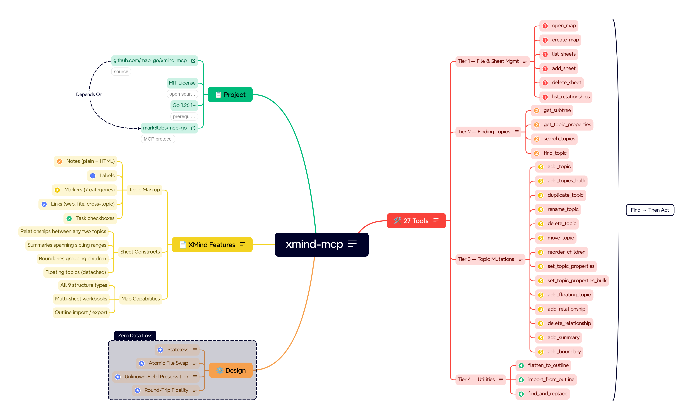

# xmind-mcp

<p align="center">
  <a href="https://github.com/mab-go/xmind-mcp/actions"></a>
  <a href="https://codecov.io/gh/mab-go/xmind-mcp"></a>
  <a href="https://pkg.go.dev/github.com/mab-go/xmind-mcp"></a>
  <a href="https://deepwiki.com/mab-go/xmind-mcp"></a>
  <a href="LICENSE"></a>
</p>

An [MCP (Model Context Protocol)](https://modelcontextprotocol.io) server for
reading and writing local [XMind](https://xmind.com) mind map files. XMind MCP
exposes 27 tools that let any MCP-compatible AI client create, navigate, and
edit `.xmind` files directly on disk.

> **Note:** xmind-mcp is an independent project. It is not affiliated with,
> endorsed by, or sponsored by SUPERMIND PTE. LIMITED, the maker of XMind. The
> XMind name is used only to identify the app and file format this server
> works with.

<p align="center">
  
</p>

------------------------------------------------------------------------

## Prerequisites

### Building

- Go 1.26.1 or later

### Using

- Any MCP client that can start a local stdio server. See
  [MCP Client Configuration](#mcp-client-configuration) for Claude Desktop,
  Claude Code, VS Code and Cursor.

------------------------------------------------------------------------

## Installation

### Using `go install` (recommended)

```bash
go install github.com/mab-go/xmind-mcp/cmd/xmind-mcp@latest
```

This fetches, builds, and installs the binary in one step. No cloning
required.

### Build from source

```bash
git clone https://github.com/mab-go/xmind-mcp.git
cd xmind-mcp
make build
```

The binary is written to `./bin/xmind-mcp` with version metadata from
`git` (see the `build` target in the `Makefile`). A plain
`go build ./cmd/xmind-mcp` also works but omits those ldflags.

> **Note:** A multi-platform container image is published to
> [GHCR](https://github.com/mab-go/xmind-mcp/pkgs/container/xmind-mcp) on
> each push to `main` and on version tags (see **Docker** below). Pre-built
> binaries for Linux and Windows are attached to each tagged
> [GitHub Release](https://github.com/mab-go/xmind-mcp/releases).

------------------------------------------------------------------------

## Docker

The image `ghcr.io/mab-go/xmind-mcp` runs the same stdio MCP server as the
host binary. Mount a host directory that contains your `.xmind` files and pass
paths **as seen inside the container** to the tools (for example, if you mount
`/home/you/maps` at `/maps`, use `/maps/my-map.xmind` in tool calls).

Build and load locally (single platform):

```bash
docker buildx build --platform linux/amd64 --load -t xmind-mcp:test .
```

Optional build arguments (defaults match a local build without git in context):

```bash
docker buildx build \
  --platform linux/amd64 \
  --load \
  --build-arg VERSION="$(git describe --tags --always --dirty 2>/dev/null || echo dev)" \
  --build-arg COMMIT="$(git rev-parse HEAD 2>/dev/null || echo unknown)" \
  --build-arg DATE="$(date -u +%Y-%m-%d)" \
  -t xmind-mcp:test .
```

Multi-platform build (no `--load`; suitable for CI or registry push):

```bash
docker buildx build --platform linux/amd64,linux/arm64 .
```

**Linux (amd64 host):** Building the `linux/arm64` variant runs `RUN` steps
inside an ARM image. Without [QEMU user emulation](https://docs.docker.com/build/building/multi-platform/#qemu),
those steps fail with `exec format error`. Install binfmt handlers once:

```bash
docker run --privileged --rm tonistiigi/binfmt --install all
```

Docker Desktop on macOS and Windows usually includes this. If you only need to
check that the Dockerfile builds on your machine, use `linux/amd64` only (the
first command above).

Run interactively (stdio requires `-i`):

```bash
docker run --rm -i -v /path/on/host:/maps xmind-mcp:test --version
```

To run the image from an MCP client, see
[Running the Docker image](#running-the-docker-image).

------------------------------------------------------------------------

## MCP Client Configuration

xmind-mcp is a stdio server: the client starts the `xmind-mcp` binary and
talks to it over standard input and output. The binary takes no arguments.

### Command and map paths

**Command.** `go install` puts the binary in `$(go env GOPATH)/bin`, usually
`~/go/bin`. If that directory isn't on your `PATH`, use the full path to the
binary as the command; `which xmind-mcp` prints it (`where xmind-mcp` on
Windows). Do the same if a desktop app can't start the server even though the
command works in a terminal: apps started from a dock or menu may not see your
shell's `PATH`. In JSON on Windows, double each backslash, as in
`"C:\\Users\\you\\go\\bin\\xmind-mcp.exe"`.

**Map paths.** Every tool takes the path to a `.xmind` file. A relative path
resolves against the server's working directory, which the client chooses and
which is often not the folder you're working in (for Claude Desktop it may be
`/`). Refer to maps by absolute path; the server tells the model the same.

### Claude Code

```bash
claude mcp add --scope user xmind -- xmind-mcp
```

`--scope user` makes the server available in every project. Without it, the
server is added for the current project only. `--scope project` instead writes
a `.mcp.json` file in the project root to share with collaborators; it uses
the same JSON as the [VS Code](#vs-code) example, and Claude Code asks each
person to approve it before it connects. Check the server with
`claude mcp list`, or with `/mcp` inside a session.

### Claude Desktop

Open the config file from the Claude menu with **Settings > Developer > Edit
Config**, or edit it directly:

- macOS: `~/Library/Application Support/Claude/claude_desktop_config.json`
- Windows: `%APPDATA%\Claude\claude_desktop_config.json`
- Linux: `~/.config/Claude/claude_desktop_config.json`

Add the server under `mcpServers`:

```json
{
  "mcpServers": {
    "xmind": {
      "command": "xmind-mcp"
    }
  }
}
```

Then quit Claude Desktop completely and start it again, so it loads the new
configuration.

### VS Code

Run **MCP: Add Server** from the Command Palette, choose **Command (stdio)**,
enter `xmind-mcp`, and name the server `xmind`. Or add it by hand to
`~/.copilot/mcp-config.json` (all workspaces) or to `.mcp.json` at the
workspace root:

```json
{
  "mcpServers": {
    "xmind": {
      "type": "stdio",
      "command": "xmind-mcp"
    }
  }
}
```

The older VS Code format, in `.vscode/mcp.json` or the user-profile
`mcp.json`, still works. It uses a top-level `servers` key instead of
`mcpServers`.

### Cursor

Add the same JSON as for [VS Code](#vs-code) to `~/.cursor/mcp.json` (all
projects) or to `.cursor/mcp.json` in a project. Cursor loads a project's
servers only after you approve them. Cursor's CLI shows whether the server
connected: `agent mcp list`.

### Running the Docker image

To use the [Docker image](#docker) instead of a local binary, the client
starts `docker`. For Claude Desktop, VS Code or Cursor, set `command` and
`args`:

```json
{
  "mcpServers": {
    "xmind": {
      "command": "docker",
      "args": [
        "run",
        "-i",
        "--rm",
        "-v",
        "/path/on/host:/maps",
        "-w",
        "/maps",
        "ghcr.io/mab-go/xmind-mcp:latest"
      ]
    }
  }
}
```

For Claude Code:

```bash
claude mcp add --scope user xmind -- docker run -i --rm \
  -v /path/on/host:/maps -w /maps ghcr.io/mab-go/xmind-mcp:latest
```

The server sees only the mounted directory, at its path inside the container:
with `/home/you/maps` mounted at `/maps`, ask for `/maps/my-map.xmind`.
`-w /maps` makes relative paths resolve inside the mount, since the image's
working directory is `/`. To use host paths unchanged, mount the directory at
the same path: `-v /home/you/maps:/home/you/maps`.

The container runs as root, so on a Linux host the maps it creates or saves
become owned by root. To keep them yours, add `--user` with your user and
group IDs (from `id -u` and `id -g`), for example `"--user", "1000:1000"` in
`args`. `claude mcp add` runs in your shell, so `--user "$(id -u):$(id -g)"`
works there.

### Log level

The server logs to standard error at `info` level by default. To change it,
pass the `--log-level` flag or set the `XMIND_MCP_LOG_LEVEL` environment
variable (the flag wins if both are set). Accepted values are `debug`, `info`,
`warn`, and `error`; an unrecognized value exits with an error at startup.

If a tool handler panics, the server keeps running: it returns an internal
error to the client and logs an `error`-level `tool.panic` line with a stack
trace, whatever the log level.

`debug` adds per-connection lifecycle detail: the client's name and MCP
protocol version, logged at the `initialize` handshake or, for clients on
protocol 2026-07-28, at `server/discover`. To enable it from a JSON client
config (Claude Desktop, VS Code or Cursor), set it via `env`:

```json
{
  "mcpServers": {
    "xmind": {
      "command": "xmind-mcp",
      "env": { "XMIND_MCP_LOG_LEVEL": "debug" }
    }
  }
}
```

In Claude Code, pass the flag after the command:

```bash
claude mcp add --scope user xmind -- xmind-mcp --log-level debug
```

`claude mcp add -e XMIND_MCP_LOG_LEVEL=debug` also works, but the CLI rejects
a server name placed directly after `-e`, so put the name first.

------------------------------------------------------------------------

## Tools

All tools are prefixed with `xmind_` to avoid collisions in multi-server
environments. Each tool also carries MCP annotations (a display title plus
read-only, destructive, and idempotent hints), so clients can auto-approve
reads and ask before destructive edits. The server also sends short usage
instructions when a client connects; clients that support them add them to the
model's context. Tools that return JSON also declare an output schema and
return the same data as `structuredContent`, so clients that support MCP
structured output can use it without parsing text.

### Tier 1: File & Sheet Management

| Tool                       | Description                                                                                    |
|----------------------------|------------------------------------------------------------------------------------------------|
| `xmind_open_map`           | Parse a `.xmind` file and return a structural summary (sheet names, root topics, node counts). |
| `xmind_list_sheets`        | Return the names and IDs of all sheets in a workbook.                                          |
| `xmind_create_map`         | Create a new `.xmind` file with a single sheet and root topic.                                 |
| `xmind_add_sheet`          | Add a new sheet to an existing workbook.                                                       |
| `xmind_delete_sheet`       | Remove a sheet from a workbook.                                                                |
| `xmind_list_relationships` | List all relationships on a sheet (endpoint ids and topic titles as JSON).                     |

### Tier 2: Finding Topics

Use these to resolve topic ids and titles before editing a specific branch
of the tree. Some write tools instead need sheet-level ids or ids from
`xmind_list_relationships`—see each tool's description.

| Tool                         | Description                                                                                                                                                                                                        |
|------------------------------|--------------------------------------------------------------------------------------------------------------------------------------------------------------------------------------------------------------------|
| `xmind_get_subtree`          | Return the full topic hierarchy rooted at a given topic (or the whole sheet); floating and summary topics are marked with `childType`.                                                                             |
| `xmind_get_topic_properties` | Return one topic's metadata as JSON (notes, markers, boundaries, sheet relationships for that topic, child counts); use to verify writes.                                                                          |
| `xmind_search_topics`        | Search topics by keyword; returns matches with IDs, ancestryPath (titles from sheet root to parent of match, or null at sheet root), parent title, depth, childType, and sheet fields when searching all sheets.   |
| `xmind_find_topic`           | Find a single topic by exact title; returns ID, ancestryPath (sheet-root chain to parent of match; null at sheet root; not relative to parent_id scope), plus parent/sibling context relative to the search scope. |

### Tier 3: Topic Mutations

Most tools here target a topic and take a `topic_id` from Tier 2 (or from
prior results). A few use other ids (`from_id`/`to_id`, `relationship_id`,
etc.)—see each row.

On success, **`xmind_add_topic`**, **`xmind_add_topics_bulk`**,
**`xmind_duplicate_topic`**, and **`xmind_move_topic`** return **JSON** (topic
ids, insertion indices, sibling counts, and related fields). Each one declares
an output schema listing the exact keys, which clients see in `tools/list`.
Other mutation tools in this tier return plain-text success messages unless
their descriptions say otherwise.

| Tool                              | Description                                                                                                                                             |
|-----------------------------------|---------------------------------------------------------------------------------------------------------------------------------------------------------|
| `xmind_add_topic`                 | Add a child under a parent; optional notes, labels, markers, link, `remove_markers` (same rules as `xmind_set_topic_properties`); success body is JSON. |
| `xmind_add_topics_bulk`           | Add many topics (flat or nested); each object may set the same optional metadata fields; success body is JSON.                                          |
| `xmind_duplicate_topic`           | Deep-clone a topic subtree under another parent (same sheet); sheet relationships are not copied; success body is JSON.                                 |
| `xmind_rename_topic`              | Change the title of an existing topic.                                                                                                                  |
| `xmind_delete_topic`              | Remove a topic and all its descendants.                                                                                                                 |
| `xmind_move_topic`                | Move a topic (and subtree) to a new parent; optional `position` sets insertion order (omit to append); success body is JSON.                            |
| `xmind_reorder_children`          | Change the order of a topic's children without reparenting.                                                                                             |
| `xmind_set_topic_properties`      | Set or update topic metadata (notes, labels, markers, link, remove_markers); clearing rules are on the tool.                                            |
| `xmind_set_topic_properties_bulk` | Apply the same metadata updates as `xmind_set_topic_properties` to many topic IDs in one read/write.                                                    |
| `xmind_add_floating_topic`        | Add a detached floating topic not connected to the main hierarchy.                                                                                      |
| `xmind_add_relationship`          | Draw a labeled connector between any two topics.                                                                                                        |
| `xmind_delete_relationship`       | Remove a relationship by id (from `xmind_list_relationships`).                                                                                          |
| `xmind_add_summary`               | Add a summary callout bracketing a range of sibling topics.                                                                                             |
| `xmind_add_boundary`              | Add a visual boundary enclosure around all children of a topic.                                                                                         |

### Tier 4: Utilities

| Tool                        | Description                                                                                                                                                                         |
|-----------------------------|-------------------------------------------------------------------------------------------------------------------------------------------------------------------------------------|
| `xmind_flatten_to_outline`  | Export a sheet or subtree as indented plain text or Markdown.                                                                                                                       |
| `xmind_import_from_outline` | Build a map or branch from an indented plain text or Markdown outline.                                                                                                              |
| `xmind_find_and_replace`    | Replace text in topic titles (case-insensitive substring, or whole-title match with `exact_match`) on one sheet, or on all sheets when `sheet_id` is omitted; success body is JSON. |

------------------------------------------------------------------------

## Development

First time only, install project-local tools (golangci-lint, goimports,
gocyclo) into `./bin`:

```bash
make setup
```

Then:

```bash
# Build (binary in ./bin/xmind-mcp), tests, and lint
make build test lint

# Run the server locally (stdio MCP)
make run
```

The primary test fixture is located at `testdata/kitchen-sink.xmind`. It
exercises every supported XMind feature and should be used as the baseline for
any handler development and testing. That file is stored in **Git LFS**; use a
clone with LFS enabled (or run `git lfs pull`) before `make test`, or tests will
fail on a pointer stub.

------------------------------------------------------------------------

## License

MIT. See [LICENSE](LICENSE).
